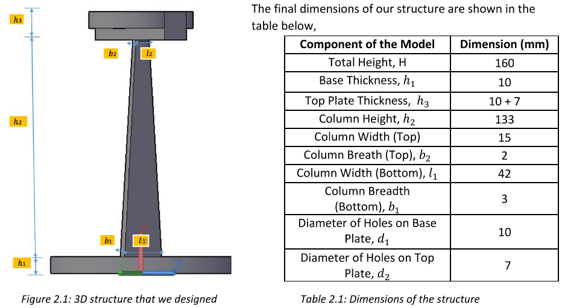

# Dynamics of Structures: SDOF Shaking-Table Model

Group coursework for Dynamics of Structures, 3rd year Civil Engineering at Imperial College London (2018). The task was to design a small 3D-printed structure, idealised as a single-degree-of-freedom (SDOF) system, that survives three harmonic base motions on a shaking table at the lowest mass. A brute-force MATLAB search chose the column dimensions.

📄 [Report](docs/report.pdf)

## Problem

- Base motions of 10, 10 and 20 mm amplitude at 1.5, 2.5 and 3.5 Hz
- Natural period between 0.35 s and 0.7 s
- Maximum relative displacement under 30 mm
- Tensile and shear stresses within the strength of 3D-printed ABS or PLA, with no buckling under self-weight
- A 50 × 25 mm platform on top carrying two 250 g masses

## Approach

The design is a cantilever with a tapered rectangular column, widest at the fixed base where the bending moment is largest.

[`src/MainScript5.m`](src/MainScript5.m) searches column widths and depths at the top and bottom, for both materials. For each candidate it:

1. Lumps the mass at the top and derives stiffness for the tapered section by virtual work: K = E / ∫(L−x)²/I(x) dx
2. Computes the natural period and the undamped dynamic amplification for each load case
3. Checks bending and shear stress against the material strength with factors of safety, plus self-weight buckling (Rayleigh method)
4. Repeats the checks for all 2⁵ combinations of ±0.1 mm printing error, so the printed part still passes
5. Keeps the lightest design that passes every check

## Results

The chosen ABS design has a 133 mm column tapering from 42 × 3 mm to 15 × 2 mm. Its predicted natural period was 0.525 s, and the shaking-table test measured 0.51 s, within 3%. The structure didn't fail.

Measured displacements differed from predictions by up to 60%. The report traces this to:

- Damping, which the design neglected to stay conservative
- A second degree of freedom: the top platform rotated during the test
- A lighter print than designed (60 g measured against 79 g designed)

## Acknowledgements

Taught by Dr. Christian Málaga-Chuquitaype.
